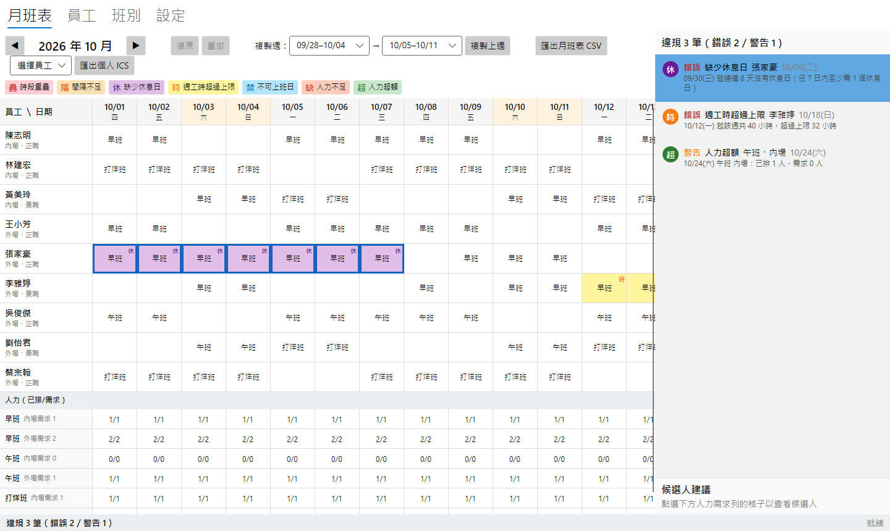
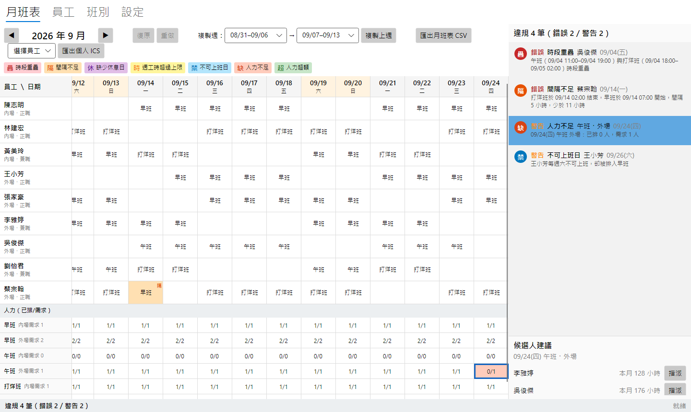
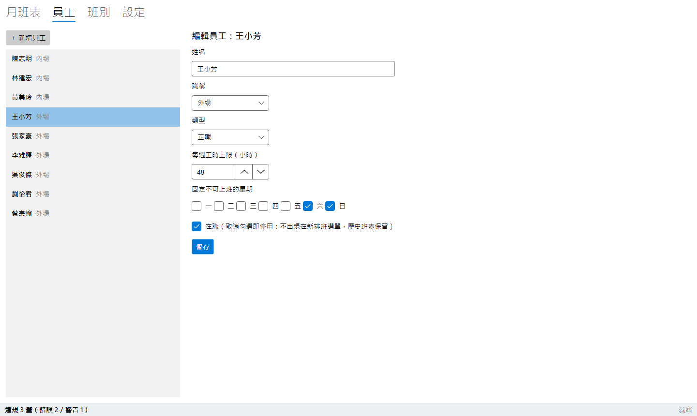

# 班表守門員 RosterGuard

[](https://github.com/hn83320589/RosterGuard/actions/workflows/ci.yml)

給小型餐飲店店長的桌面排班工具：**排的當下就看得到哪裡違規**，並在人力不足時列出「指派後不會產生任何新違規」的候選人。

- C# / .NET 9、Avalonia UI 11（MIT）、MVVM（CommunityToolkit.Mvvm）
- 本機 SQLite（`%LocalAppData%\RosterGuard\rosterguard.db`），每次編輯自動儲存
- 不呼叫任何網路服務、不使用付費授權套件



---

## 功能

| 功能 | 說明 |
|---|---|
| 員工管理 | 姓名、職稱（內場／外場）、類型（正職／兼職）、每週工時上限（可 0.5 小時）、固定不可上班的星期（可複選）；新增、編輯、停用 |
| 班別管理 | 名稱、起訖時間（結束 ≤ 開始代表跨日，例如 18:00–02:00）、內場／外場每班需求人數；新增、編輯、停用 |
| 月班表 | 員工 × 日期格網，點格子勾選班別（一格可多班），取消勾選即取消指派；◀ ▶ 切換月份 |
| 複製上週 | 選擇來源週與目標週，一鍵複製 |
| 即時規則檢查 | 任何編輯後立即重算 6 條規則，格子以顏色＋單字徽章標示，狀態列顯示違規總數 |
| 違規面板 | 依嚴重度 → 日期排序；點選一筆自動捲動並以藍框標示相關格子 |
| 候選人建議 | 點人力需求列（或「人力不足」違規）列出可指派者，依本月累計工時由少到多；一鍵指派；無人可用時顯示原因 |
| 復原／重做 | 指派、取消指派、複製上週皆可 `Ctrl+Z` / `Ctrl+Y`（100 層），違規清單同步還原 |
| 匯出 | 月班表 CSV（UTF-8 with BOM，Excel 直接開啟不亂碼）；個人班表 .ics（Outlook／Google 日曆） |





---

## 建置與執行

需求：Windows 10/11、[.NET 9 SDK](https://dotnet.microsoft.com/download/dotnet/9.0)。

```powershell
git clone https://github.com/hn83320589/RosterGuard.git
cd RosterGuard
dotnet build -c Release
dotnet test -c Release                          # 單元測試 + Avalonia Headless 測試
dotnet run --project src/RosterGuard.App        # 啟動
```

發佈單一執行檔（與 CI 相同）：

```powershell
dotnet publish src/RosterGuard.App/RosterGuard.App.csproj -c Release -r win-x64 `
  --self-contained true -p:PublishSingleFile=true -p:IncludeNativeLibrariesForSelfExtract=true -o publish/win-x64
```

- 首次啟動（資料庫不存在）會自動載入範例資料；之後可在「設定 → 重設為範例資料」重新載入。
- 環境變數 `ROSTERGUARD_DB` 可指定其他資料庫檔案位置（示範或測試用）。
- 重新產生 README 截圖：`$env:ROSTERGUARD_SCREENSHOTS="docs/screenshots"; dotnet test tests/RosterGuard.App.Tests --filter ScreenshotGenerator`

## 操作說明

1. **排班**：在「月班表」點員工某天的格子，勾選班別即指派、取消勾選即取消；停用的班別不會出現在選單（已排的歷史指派仍顯示）。
2. **看違規**：格子底色為最嚴重的違規類型，右上角徽章列出所有類型（疊／隔／休／時／禁／缺／超，圖例在格網上方）；滑鼠停留可看說明。
3. **定位違規**：點右側違規面板任一筆，格網自動捲動並以藍框標示。
4. **補人力**：格網下方「人力（已排/需求）」列紅底為不足、綠底為超額；點格子即在右下列出候選人，按「指派」完成。
5. **複製上週**：工具列選來源週 → 目標週，按「複製上週」。
6. **匯出**：「匯出月班表 CSV」匯出目前月份；選擇員工後按「匯出個人 ICS」。

---

## 架構

```
RosterGuard.App  (Avalonia 11, MVVM)  ──►  RosterGuard.Data (Microsoft.Data.Sqlite)
        │                                          │
        └──────────────►  RosterGuard.Core  ◄──────┘   純 net9.0，不引用 Avalonia、無 IO
```

| 專案 | 內容 |
|---|---|
| `src/RosterGuard.Core` | `Domain`（員工、班別、指派）、`Time`（跨日時段、週計算）、`Rules`（6 條規則 + RuleEngine）、`Candidates`（候選人）、`History`（Undo/Redo、指令）、`Export`（CSV、ICS）、`Session`（RosterSession、IRosterStore）、`Seed`（範例資料） |
| `src/RosterGuard.Data` | `SqliteRosterStore`：實作 `IRosterStore`，schema 以 `PRAGMA user_version` 管理版本 |
| `src/RosterGuard.App` | Views（AXAML）＋ ViewModels；`AppBootstrapper` 為 composition root |
| `tests/RosterGuard.Core.Tests` | xUnit：規則邊界、時間、候選人、Undo/Redo、匯出（以 Ical.Net 解析驗證）、SQLite 整合、範例資料對照 |
| `tests/RosterGuard.App.Tests` | Avalonia.Headless.XUnit：啟動、指派＋Ctrl+Z、違規點選捲動、切換月份、候選人一鍵指派 |

**資料流**：UI 的所有編輯都經過 `RosterSession.Execute(command)`。指令只根據目前狀態算出差量（`RosterDelta`：新增／刪除的指派），Session 先寫入 SQLite（單一交易）、再更新記憶體、最後**全量重算違規**並發出 `Changed` 事件，ViewModel 據此更新格子與面板。復原就是套用反向差量，所以違規清單永遠由狀態導出，撤銷後自動同步。

詳細設計與取捨見 [docs/architecture.md](docs/architecture.md)。

---

## 規則判定方式

共同約定：
- 班別時段為**半開區間 `[開始, 結束)`**，以本地牆鐘時間計算；結束 ≤ 開始代表跨到隔天（18:00–02:00 = 8 小時，結束於隔天 02:00；08:00–08:00 = 24 小時）。
- 時數一律以**整數分鐘**計算，避免浮點誤差影響邊界判定。
- 指派的日期是班別的**開始日**。
- 評估某月份時，會同時載入前後 7 天的指派作為上下文，因此跨月的間隔、連續工作與週工時都能正確判定；面板只列出「錨點日期」落在本月的違規。

| 規則 | 嚴重度 | 判定方式 | 錨點／標示 |
|---|---|---|---|
| 時段重疊 | 錯誤 | 同一員工任兩班 `a.開始 < b.結束 且 b.開始 < a.結束`。首尾相接（15:00 結束、15:00 開始）不算重疊 | 較晚開始那班的日期；兩班的格子都標示 |
| 間隔不足 | 錯誤 | 依開始時間排序，`下一班開始 − 之前所有班中最晚的結束` 介於 0 與最小間隔（預設 11 小時，可調）之間。**剛好 11 小時不違規、少 1 分鐘違規**。已重疊（間隔為負）交給「時段重疊」，不重複回報 | 後一班的日期 |
| 缺少休息日 | 錯誤 | 休息日 = 該日 `[00:00, 24:00)` 內沒有任何班別時段。連續 ≥ 7 個非休息日即違規，**每段連續區間只報一筆**。打烊班 18:00–02:00 會讓隔天不是休息日；16:00–00:00 則不會 | 區間第 7 天（若早於本月則為本月 1 日）；區間內本月的格子 |
| 週工時超過上限 | 錯誤 | 每週自**週一**起算，班別依開始日歸週，週總時數**大於**上限才違規（剛好等於不違規） | 使累計超過上限的那一班；該週本月內的格子 |
| 不可上班日 | 警告 | 班別開始日的星期屬於員工固定不可上班的星期（週六打烊班跨到週日 02:00，不算週日） | 該格 |
| 人力不足／超額 | 警告 | 本月每一天 × 每個**啟用中**班別 × 每個職稱，已排人數 ≠ 需求人數；內場、外場分開計算，不互相抵銷 | 格網下方人力需求列 |

排序：嚴重度（錯誤在前）→ 錨點日期 → 規則類型 → 員工姓名。

**候選人建議**：對人力不足的（日期、班別、職稱），候選池為在職、職稱相符、尚未排該班的員工。對每人試算「指派後」的違規（以缺口日期為中心前後 7 天評估，月底缺口也會看完整個跨月週），同時滿足兩項才可用：(1) 違規鍵集合不超過「指派前」；(2) 這一格不在該員工任何一筆違規的範圍內。第 (2) 項擋下已經超過週工時上限、或已連上 7 天以上的人，不論缺口在週內哪個位置都一樣；與這一格無關的既有違規（例如別週的違規）不會擋人。排序為本月累計工時（依開始日在本月）由少到多 → 姓名（Unicode 碼位，結果穩定）→ Id。無人可用時，統計每位候選人第一個新增的違規，例如「全部候選人都會違反間隔規則」或「沒有可用的候選人：2 人違反間隔規則、1 人違反不可上班日規則」。

**複製上週**：先清空目標週（只限本月範圍內的日期）再複製來源週的指派；已停用的員工與班別不複製，它們在目標週的歷史指派也保留不清除；整個動作是一個復原步驟。

**匯出**：CSV 為員工列 × 日期欄（多班以 `/` 分隔），最後一欄為本月工時，UTF-8 with BOM、CRLF、RFC 4180 跳脫。ICS 為 RFC 5545，附 `VTIMEZONE Asia/Taipei`（固定 +08:00），`DTSTART;TZID=Asia/Taipei`，UTF-8 無 BOM、CRLF、文字跳脫、75 octets 折行（不切斷中文字）。

---

## 範例資料

9 位員工、3 個班別（早班、午班、打烊班）與 2026 年 9–10 月班表：基準輪班無任何違規，另有 7 處刻意修改分別觸發每一種違規（含跨月的連續工作）。預期違規清單見 [samples/expected-violations.md](samples/expected-violations.md)，並由 `SampleDataTests` 自動比對。

## 測試

```powershell
dotnet test
```

- 單元測試 112 個（Core + SQLite 整合），涵蓋各規則邊界、跨日計算、候選人排序與原因、Undo/Redo（≥ 20 層、redo 清空、撤銷後違規還原）、CSV／ICS。
- Avalonia Headless 測試 5 個（另有 1 個預設不執行的截圖產生器）。
- 驗收標準逐項對照與人工實測清單見 [docs/test-report.md](docs/test-report.md)。

## CI

`.github/workflows/ci.yml`：在 `windows-latest` 以 `setup-dotnet 9.0.x` 還原、建置、測試，發佈 win-x64 單一執行檔並上傳為 artifact（`RosterGuard-win-x64`），測試結果（trx）另存為 `test-results`。

---

## 設計取捨

| 決策 | 理由 |
|---|---|
| 每次編輯全量重算 | 資料量極小（每月數百筆），正確性與可讀性優先於增量演算法 |
| Core / Data / App 三層 | Core 完全無 IO，Session 可用 in-memory store 單元測試；SQLite 細節集中在 Data |
| 手寫 SQL（Microsoft.Data.Sqlite），不用 EF Core | 4 張表，不值得 migration 與追蹤成本 |
| 指令只計算差量 | 復原只需反向套用；複製上週天然是一個步驟；差量也直接拿來寫入資料庫 |
| 違規鍵不含訊息與人數 | 候選人比對「新違規」時，「人力 0/2 → 1/2」不會被誤判為新違規 |
| 自訂格網而非 DataGrid | 31 個動態欄位、捲動到指定格子與高亮較容易，Headless 測試也較好操作 |
| ICS 手寫，測試用 Ical.Net 驗證 | 正式程式不多一個相依套件，同時保證標準解析器可讀 |
| 所有指派載入記憶體 | 單店多年資料也只有數千筆；切月份、跨月復原都不需重新查詢 |

## 已知限制

- 修改班別的起訖時間會**回溯影響**所有月份（指派只記錄班別 Id，不保存當時的時間）。
- 復原／重做歷史只存在於本次執行期間，關閉程式後不保留；員工、班別、設定的編輯不列入復原。
- 「重設為範例資料」會清除所有資料且無法復原（有二次確認）。
- 員工姓名排序依 Unicode 碼位，不是中文筆劃。
- 停用的班別不檢查人力需求；停用員工的歷史指派仍參與規則判定。
- 僅在 Windows 上建置與測試；Avalonia 雖跨平台但未驗證其他系統。
- 不處理到職／離職日、請假、國定假日、特定日期的人力需求覆寫（依需求範圍）。
- 匯出的 ICS 為目前顯示月份的班表。
- 最小間隔設定範圍為 0–24 小時；每週工時上限為 0.5–168 小時。

## 授權

使用的套件皆為 MIT／Apache-2.0 授權：Avalonia、CommunityToolkit.Mvvm、Microsoft.Data.Sqlite、xUnit、Ical.Net（僅測試）。
