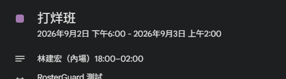
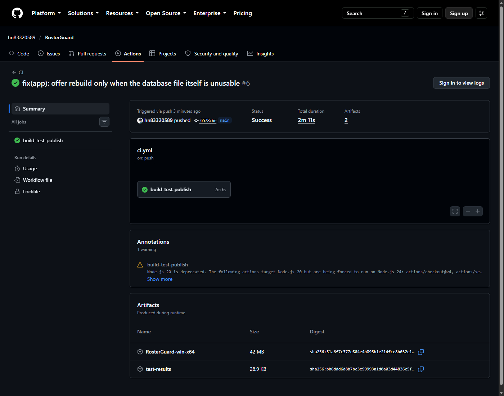
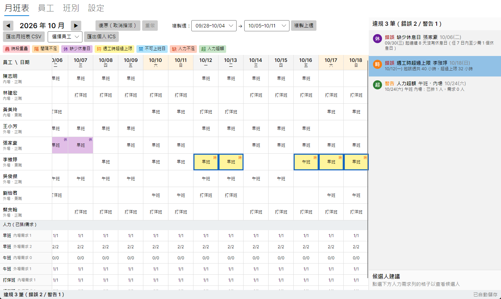

# RosterGuard 測試報告

- 日期：2026-10-16（審查後修正版）
- 版本：`main` @ `6578cbe`
- 環境：Windows 11 Pro 10.0.26200、.NET SDK 9.0.315、Microsoft Excel 16.0、Google 日曆（網頁版）
- 執行指令：

```powershell
dotnet build -c Release --no-incremental
dotnet test -c Release --no-build --logger trx
dotnet publish src/RosterGuard.App -c Release -r win-x64 --self-contained true `
  -p:PublishSingleFile=true -p:IncludeNativeLibrariesForSelfExtract=true
```

## 1. 結論

| 項目 | 結果 |
|---|---|
| Release 建置 | ✅ 0 警告、0 錯誤（`TreatWarningsAsErrors` 開啟） |
| 單元測試（RosterGuard.Core.Tests） | ✅ 115／115 通過，0 略過 |
| App 測試（RosterGuard.App.Tests） | ✅ 22／22 通過：Headless 8 個（主視窗 5、啟動錯誤視窗 3）＋啟動錯誤訊息與重建按鈕條件的單元測試 14 個。另有 1 個截圖產生器，未設定環境變數時不做任何事，不計入 |
| win-x64 單一執行檔發佈 | ✅ `RosterGuard.exe` 約 95 MB；正常資料庫可開啟主視窗，損毀資料庫會顯示錯誤視窗（見 4.2） |
| GitHub Actions | ✅ [run 38862401106](https://github.com/hn83320589/RosterGuard/actions/runs/38862401106)（commit `6578cbe`，windows-latest）全部步驟成功，artifact：`RosterGuard-win-x64`（42 MB，zip 壓縮後）、`test-results`。截圖見 4.3 |
| CSV 以 Excel 開啟 | ✅ 實際以 Excel 16.0 開啟，中文正確（見 4.1） |
| ICS 匯入行事曆 | ✅ 匯入 Google 日曆成功，中文標題與跨午夜起訖正確（見 4.1）。Outlook 因本機沒有郵件設定檔無法測試 |
| 人工實測清單 #1、#3、#9、#11、#12 | ✅ 以 UI Automation 操作實際 exe，30 項檢查全部通過（見 4.4） |

## 2. 審查後修正

| 問題 | 修正 | 新增測試 |
|---|---|---|
| 候選人建議對已有違規的員工判斷不一致：已超過週工時上限的人，缺口在週內較晚的位置時仍被推薦；已連上 7 天的人，第 8 天仍被推薦 | 除了「不產生新的違規鍵」，再要求「這一格不落在該員工任何違規的範圍內」。候選人評估改以缺口日期為中心（回報 ±7 天、讀入 ±14 天），月底缺口也會看完整個跨月週 | `CandidateFinderTests`：缺口在週內前、中、後三個位置（Theory 3 筆）、別週超時不擋人、月底跨月週、已連上 7 天 |
| 啟動時資料庫損毀、版本不符、被鎖定或無法存取會直接崩潰 | 顯示錯誤視窗，依原因說明，提供「重試」「舊檔改名保留並重建」「結束」。舊檔改名為 `*.broken-yyyyMMdd-HHmmss`，不刪除。版本不符改用專用的 `UnsupportedSchemaException`，啟動時不必攔截所有 `InvalidOperationException` | `SqliteRosterStoreTests`：損毀檔、版本不符、改名後重建；`StartupErrorTests`：各錯誤碼的說明文字、損毀時的視窗與重建、重試仍失敗時保留原檔 |
| 啟動錯誤視窗對「被鎖定」「沒有權限」也顯示重建按鈕，使用者可能把完好的資料庫改名移走（第二輪審查） | 「舊檔改名保留並重建」只在檔案損毀、不是資料庫、版本不符時顯示，按鈕的 Command 也同步停用；重試後錯誤類型改變時會重新判斷 | `StartupErrorTests`：9 種錯誤的按鈕條件、被鎖定時按鈕隱藏（Headless） |
| 「複製上週」會刪除停用員工在目標週的歷史指派 | 不複製的指派（停用員工或停用班別）在目標週也不清除 | `CopyWeekCommandTests.Target_week_history_of_inactive_employees_and_shift_types_is_kept` |

## 3. 測試分布

| 測試類別 | 數量 | 涵蓋內容 |
|---|---:|---|
| Time.ShiftTimeTests | 10 | 跨午夜班別的時數與起訖、週一為一週起點 |
| Rules.RestGapRuleTests | 9 | 最小間隔：11 小時邊界、跨午夜、跨月、可調參數 |
| Rules.RestDayRuleTests | 7 | 缺少休息日：第 7 日邊界、跨月錨點、跨午夜尾段不算休息 |
| Rules.WeeklyHoursRuleTests | 6 | 週工時：剛好等於上限、半小時、週日跨午夜班歸屬 |
| Rules.UnavailableAndOverlapRuleTests | 6 | 不可上班日與時段重疊各自獨立判定 |
| Rules.StaffingRuleTests | 6 | 人力不足／超額，各職稱分開計算 |
| Rules.RuleEngineTests | 2 | 違規排序、未知班別立即失敗 |
| Candidates.CandidateFinderTests | 16 | 候選人過濾、排序穩定性、無人可用時的原因、已超限者不推薦（缺口位置對稱、跨月週） |
| History.UndoRedoStackTests | 4 | 容量、清空 redo |
| History.CopyWeekCommandTests | 6 | 複製上週的範圍、停用資料不複製也不清除、單步撤銷 |
| Session.RosterSessionTests | 14 | 指派／撤銷／重做 ≥20 層、跨月撤銷、儲存失敗時狀態不變 |
| Export.CsvRosterExporterTests | 5 | UTF-8 BOM、欄位跳脫、欄數依月份天數 |
| Export.IcsExporterTests | 5 | Ical.Net 解析、中文標題、75 octets 折行、CRLF |
| Data.SqliteRosterStoreTests | 14 | 重開後資料不變、交易回滾、停用員工保留歷史、損毀檔與版本不符、改名後重建 |
| Seed.SampleDataTests | 5 | 範例資料與 `samples/expected-violations.md` 自動比對 |
| **Core 小計** | **115** | |
| MainWindowTests（Headless） | 5 | 啟動、指派＋Ctrl+Z/Y、點違規捲動、切換月份、候選人一鍵指派 |
| StartupErrorTests | 17 | Headless 3 個（損毀時的錯誤視窗與重建、重試失敗、被鎖定時隱藏重建按鈕）；錯誤說明文字 5 個；重建按鈕條件 9 個 |
| **App 小計** | **22** | |

## 4. 實機驗證

### 4.1 匯出檔

範例資料（`SampleData`）匯出 2026 年 10 月月班表 CSV，以及林建宏（有跨午夜的打烊班）的個人 ICS。

**CSV → Excel 16.0**：以 COM 呼叫 `Workbooks.Open` 開啟（不經匯入精靈、不指定編碼，由 Excel 自行判斷），讀回儲存格：

```
員工 | 職稱 | 類型 | 10/01(四) | 10/02(五) | 10/03(六)
陳志明 | 內場 | 正職 | 早班 | 早班 |
林建宏 | 內場 | 正職 | 打烊班 | 打烊班 | 打烊班
黃美玲 | 內場 | 兼職 |  |  | 早班
```

共 10 列（表頭＋9 位員工）、35 欄（3 欄基本資料＋31 天＋本月工時），中文無亂碼。

**ICS → Google 日曆**：在 Google 日曆建立一個暫時的「RosterGuard 測試」日曆，以「設定 → 匯入/匯出」把 `employee.ics` 匯入這個日曆（不動主要日曆），驗證完後整個日曆刪除。2026-09-02 那一筆打烊班的事件詳細資訊如下（截圖已裁掉帳號資訊）：



- 標題「打烊班」與說明「林建宏（內場）18:00–02:00」中文正常。
- 起訖為 9/2 18:00 到 9/3 02:00，跨午夜的結束日期正確落在隔天，時區（Asia/Taipei）正確。

**ICS → Outlook**：以 `Namespace.OpenSharedItem` 開啟（只開不存，不寫入行事曆）。依序試了三次：完整檔、只含一筆事件的檔案、手寫的最小標準 ICS，三次都失敗（「路徑或 URL 無效」「作業失敗」）。原因是本機 Outlook 沒有郵件設定檔（`Stores = 0`），與檔案格式無關。ICS 第一筆事件的原始內容如下：

```
DTSTART;TZID=Asia/Taipei:20260902T180000
DTEND;TZID=Asia/Taipei:20260903T020000
SUMMARY:打烊班
DESCRIPTION:林建宏（內場）18:00–02:00
```

### 4.2 啟動錯誤處理（實際執行發佈後的 exe）

1. 以 `ROSTERGUARD_DB` 指向內容為純文字的 `roster.db` 啟動：程式沒有結束，視窗標題為「RosterGuard 無法開啟資料庫」。
2. 以 Windows UI Automation 按下「舊檔改名保留並重建」：視窗切換為「班表守門員 RosterGuard」主視窗。資料夾內出現新的 `roster.db`（57,344 bytes），舊檔保留為 `roster.db.broken-20261016-141553`（57 bytes，原內容）。

### 4.3 CI 執行結果

以 Edge headless 截取公開的 run 頁面（未登入）：



頁面上的 1 則 warning 是 GitHub 提示 `actions/checkout@v4`、`actions/setup-dotnet@v4` 等仍以 Node.js 20 為目標，不影響這次建置結果，本次未處理。

### 4.4 人工實測清單（以 UI Automation 操作實際 exe）

`tests/ui-walkthrough/` 的兩個腳本以 Windows UI Automation 操作發佈後的 `RosterGuard.exe`：點格子、勾選 Flyout 內的班別、按工具列按鈕、切換分頁、填表單、關閉再重開程式，並讀回畫面上的文字判定結果。每次都用暫存資料夾裡的新資料庫（範例資料）。共 30 項檢查全部 PASS：

| # | 驗證內容 | 檢查數 | 結果 |
|---|---|---:|---|
| 1 | 新增員工 → 改名並把週工時上限改為 30 小時 → 新增「夜班」22:00–06:00 並改名「大夜班」 → 排一格大夜班 → 停用該員工與該班別 → **關閉重開**：員工與班別資料不變且為停用；10 月仍顯示該員工的列（標示「停用」）與歷史班表；該格選單把大夜班標為「（已停用）」，其他格子的選單沒有大夜班；11 月（沒有歷史）不出現該員工 | 13 | ✅ |
| 3 | 同一格勾選早班＋午班，格子顯示兩班；取消早班後只剩午班 | 2 | ✅ |
| 9 | 指派後狀態列違規數立即從 3 筆變 4 筆，取消後回到 3 筆；點「週工時超過上限」後格網水平捲動（0% → 29.2%），對應格子以藍框標示（下圖） | 3 | ✅ |
| 11 | 連續 25 次指派 → 撤銷 25 次，全部 279 格與違規數都還原 → 重做 25 次 → 撤銷一步後做新操作，重做按鈕變成停用 | 6 | ✅ |
| 12 | 9 月、10 月各改一格，來回切換月份內容不變，**關閉重開**後兩個月的修改都還在 | 6 | ✅ |



說明：這是以程式操作真實的視窗，判定依據是畫面上讀回的文字與捲動位置，不是人眼逐項確認；上面的截圖由我實際檢視過。

## 5. 驗收標準對照

| # | 標準 | 判定方式 | 證據 | 狀態 |
|---|---|---|---|---|
| 1 | 員工與班別新增、編輯、停用，重開後不變；停用者不在選單，歷史保留 | 實測 | `SqliteRosterStoreTests`：`Employees_round_trip…`、`Editing_an_employee…`、`Deactivated_employee_keeps_historical_assignments`；`RosterSessionTests.Inactive_employees_are_excluded…`；實際 exe 操作（4.4，13 項） | ✅ |
| 2 | 跨午夜時數與起訖正確（18:00–02:00 = 8 小時） | 單元測試 | `ShiftTimeTests.Overnight_shift_18_to_02_is_8_hours`、`Overnight_shift_ends_on_next_day` | ✅ |
| 3 | 指派、取消指派，同格多班，格網正確 | 實測＋Headless | `MainWindowTests.Assigning_through_cell_flyout…`；`RosterSessionTests.Unassign_can_be_undone`；實際 exe 操作（4.4） | ✅ |
| 4 | 間隔規則邊界：剛好 11 小時不違規、少 1 分鐘違規、跨午夜接早班 | 單元測試 | `RestGapRuleTests.Exactly_11_hours…`、`One_minute_short_of_11_hours…`、`Closing_shift_followed_by_next_morning_shift…` | ✅ |
| 5 | 缺少休息日邊界 | 單元測試 | `RestDayRuleTests.Six_work_days_then_a_rest_day…`、`Seven_consecutive_work_days…`、`Seventh_day_touched_only_by_overnight_tail…` | ✅ |
| 6 | 週工時以週一起算，等於上限不違規 | 單元測試 | `WeeklyHoursRuleTests.Exactly_at_the_limit…`、`Weeks_start_on_monday_not_rolling_seven_days` | ✅ |
| 7 | 不可上班日與重疊各自偵測、互不干擾 | 單元測試 | `UnavailableAndOverlapRuleTests`（6 個） | ✅ |
| 8 | 人力不足與超額，各職稱分開 | 單元測試 | `StaffingRuleTests.Roles_are_counted_separately` 等 6 個 | ✅ |
| 9 | 編輯後違規即時更新；點違規捲動並標示格子 | 實測＋Headless | `MainWindowTests.Clicking_a_violation_highlights_and_scrolls…`、`Assigning_through_cell_flyout…`；實際 exe 操作與截圖（4.4） | ✅ |
| 10 | 候選人只列不產生新違規者，排序穩定，無人時顯示原因 | 單元測試 | `CandidateFinderTests`（16 個，含審查後補的對稱性測試） | ✅ |
| 11 | 撤銷／重做 ≥20 層、同步還原、新操作清空 redo | 單元測試＋實測 | `RosterSessionTests.At_least_20_levels_can_be_undone`、`Undo_restores_assignments_and_violations`、`New_operation_after_undo_clears_redo`；實際 exe 操作 25 層（4.4） | ✅ |
| 12 | 各月獨立儲存、可切換、重開不變 | 實測 | `SqliteRosterStoreTests.Session_months_survive_restart_independently`；`MainWindowTests.Switching_months…`；實際 exe 操作含重開（4.4） | ✅ |
| 13 | CSV 用 Excel 開中文不亂碼；ICS 可被標準解析器讀取 | 測試＋實測 | CSV：Excel 16.0 實測（4.1）＋`Output_starts_with_utf8_bom…`；ICS：Google 日曆實測（4.1）＋`Standard_parser_reads_events_with_chinese_titles…`（Ical.Net） | ✅ CSV（Excel）／✅ ICS（Google 日曆） |
| 14 | 單元測試 ≥40 個且全數通過 | 執行測試 | 115 個通過 | ✅ |
| 15 | Headless 測試 ≥3 個，涵蓋啟動、指派、違規顯示 | 執行測試 | 8 個通過 | ✅ |
| 16 | README 含建置、截圖、架構、規則說明、已知限制 | 檢視 README | `README.md`、`docs/screenshots/` | ✅ |
| 17 | GitHub Actions 綠燈、徽章、win-x64 artifact | 檢視 Actions | [run 38862401106](https://github.com/hn83320589/RosterGuard/actions/runs/38862401106)，截圖 `docs/screenshots/ci-run.png`；README 徽章指向本 repo | ✅ |

## 6. 人工實測清單

- [x] 新增一位員工與一個跨午夜班別，關閉程式再開啟，確認資料還在；停用該員工後，確認排班選單不再出現，但既有班表仍顯示。（#1，見 4.4）
- [x] 在同一格勾選兩個班別，再取消其中一個。（#3，見 4.4）
- [x] 排一筆會違規的班，確認違規面板與格子標示立即出現；點違規項目，確認格子被捲動到並標示。（#9，見 4.4）
- [x] 連續做 20 次以上指派，全部撤銷再重做；撤銷後做新操作，確認無法再重做。（#11，見 4.4；以工具列按鈕操作，Ctrl+Z／Ctrl+Y 由 Headless 測試涵蓋）
- [x] 在 9 月、10 月各改一格，切換月份並重開程式確認。（#12，見 4.4）
- [x] 匯出 CSV 以 Excel 直接開啟。（#13，見 4.1）
- [x] 匯出 ICS 匯入 Google 日曆，確認中文標題與跨午夜班的起訖時間。（#13，見 4.1）

## 7. 已知限制與注意事項

- Headless 測試中，Flyout 內的 CheckBox 是直接設定 `IsChecked`，啟動錯誤視窗的按鈕是直接執行 Command；其餘操作（格子按鈕、違規清單項目、上下月、「指派」按鈕、Ctrl+Z／Ctrl+Y）都是模擬的滑鼠或鍵盤輸入。啟動錯誤視窗的按鈕另以實際 exe＋UI Automation 驗證過（4.2）。
- 候選人建議會擋下「這一格落在該員工既有違規範圍內」的人。若員工當天已有一班且處於違規中（例如連上第 8 天），同一天再加另一個班別也會被擋，即使連續天數不會增加。這是刻意的保守做法。
- 修改班別的起訖時間會回溯影響所有月份的違規判定。
- 撤銷歷史在關閉程式後不保留。
- 實測時觀察到的無障礙問題（未修正）：月班表的格子按鈕沒有可讀的名稱，UI Automation 讀到的是 `Avalonia.Controls.Grid`；員工、班別清單項目讀到的是資料物件的 `ToString()`（例如 `Employee { Id = 10, … }`）。螢幕閱讀器使用者會聽到這些內容。修正方式是為這些控制項設定 `AutomationProperties.Name`。
